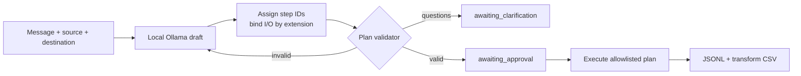

# Agent ETL Builder

Local-first ETL agent that turns a natural-language request into a **validated, executable
pipeline** — and never runs generated code.

[](CHANGELOG.md)
[](pyproject.toml)
[](LICENSE)

> **Beta software.** `0.2.0b1` is the first usable beta. It is suitable for local evaluation,
> not production. Run state is process-local, the sandbox is an in-process guard, and the API
> has no authentication hardening beyond an optional API key.

## What it does

- **Natural language → plan.** A local [Ollama](https://ollama.com/) model drafts the
  transformation steps; the system binds the source and destination deterministically from
  explicit file paths.
- **Validated before execution.** Every plan passes the same schema, registry, argument, path,
  limit, security, and approval validation used for hand-written plans.
- **Approval gate.** Writes, destructive transformations, and plans marked
  `approval_required: true` wait for `POST /runs/{run_id}/approve`.
- **Assessment first.** A source-only request profiles the file, reports quality findings, and
  proposes a conservative draft before anything is written.
- **Monitoring built in.** Every run writes redacted JSONL events and a per-step transform CSV.

Supported files: `.csv`, `.json`, `.jsonl`/`.ndjson`, `.parquet`/`.pq`.

## How it works



Safety invariants:

- The model **never** chooses the source or destination operation, supplies paths, or sees
  source values. It receives the message, registry metadata, and sampled column names/dtypes.
- Model output is constrained by a JSON schema derived from the registry, then parsed,
  bound, and validated. The validator is the final gate.
- Execution runs only validated plans through the allowlisted interpreter. Generated code is
  never executed.
- Invalid drafts are repaired with the validator error, up to the normal clarification budget.

## Quickstart

### 1. Install

```powershell
git clone https://github.com/erwingforerocastro/Agent-ETL-Builder.git
cd Agent-ETL-Builder
uv sync
```

On OneDrive or another filesystem that rejects hardlinks, set `$env:UV_LINK_MODE = "copy"`
before `uv sync`.

### 2. Start Ollama (required for natural language)

```powershell
ollama pull llama3.1:8b
ollama serve
```

In the terminal that will run the API:

```powershell
$env:AGENT_ETL_OLLAMA_MODEL = "llama3.1:8b"
```

Without this variable the API still runs structured plans and source assessment, but
natural-language planning is disabled.

### 3. Run the API

```powershell
uv run uvicorn --app-dir src main:app --reload
```

Check it:

```powershell
Invoke-RestMethod http://127.0.0.1:8000/health
```

```json
{
  "status": "ok",
  "service": "agent-etl-builder",
  "version": "0.2.0b1",
  "plan_generation": "ollama"
}
```

`plan_generation` is `disabled` when `AGENT_ETL_OLLAMA_MODEL` is unset.

### 4. Smoke test

From the repository root, with the server running:

```powershell
uv run python scripts/beta_smoke.py
```

The script exercises three flows: natural language, clarification + follow-up, and a structured
plan. It verifies `beta_output.json` and `beta_output.csv`, then prints the log paths.

## Three ways to use it

| Goal | `mode` | `source` | `destination` | `plan` |
|---|---|---|---|---|
| Natural-language pipeline | omit or `pipeline` | required | required | omit |
| Read-only assessment | `assessment` | required | omit | omit |
| Structured plan | omit | in the plan | in the plan | required |

### Natural-language pipeline

Requires `AGENT_ETL_OLLAMA_MODEL`.

```json
{
  "message": "Remove duplicate rows, trim whitespace, and save the result as JSON.",
  "source": "examples/beta/input.csv",
  "destination": "output.json"
}
```

The run returns `awaiting_approval`. Approve it:

```powershell
Invoke-RestMethod -Method Post `
  -Uri "http://127.0.0.1:8000/runs/$($run.run_id)/approve" `
  -ContentType application/json `
  -Body (@{ approved = $true } | ConvertTo-Json)
```

Inspect `logs/<run_id>.jsonl` and `artifacts/<run_id>/transform_log.csv`.

### Read-only assessment

```json
{
  "message": "Assess this file",
  "mode": "assessment",
  "source": "examples/beta/input.csv"
}
```

The response contains the assessment report and `next_action: "provide_plan"`. Assessment mode
never writes output; a supplied destination is ignored with a notice.

To assess **and then write**, omit `mode` and `destination`:

```json
{
  "message": "Assess and prepare a cleaned copy",
  "source": "examples/beta/input.csv"
}
```

The run returns `next_action: "confirm"`. Supply a destination with
`POST /runs/{run_id}/confirm`, then approve the validated plan.

### Structured plan

Submit a complete plan — not `{}`. See
[`examples/beta/plan.json`](examples/beta/plan.json) for a working template. Required fields:
`plan_version`, `mode`, `run_id`, `name`, `description`, `source`, `destination`, `chunking`,
`on_error`, and `approval_required`.

```json
{
  "message": "Run the structured plan",
  "plan": { "...": "see examples/beta/plan.json" }
}
```

## HTTP API

| Method | Path | Purpose |
|---|---|---|
| `POST` | `/runs` | Create a run from a message, source-only request, and/or structured plan. Returns `201`. |
| `GET` | `/runs/{run_id}` | Status, plan, assessment, questions, result, cleanup, and next action. |
| `POST` | `/runs/{run_id}/confirm` | Confirm an assessment and supply `{"destination": "output.csv"}`. |
| `POST` | `/runs/{run_id}/messages` | Continue a clarification run with `{"message": "..."}` and optional `source`/`destination`. |
| `POST` | `/runs/{run_id}/approve` | `{"approved": true}` or `{"approved": false}`. |
| `POST` | `/runs/{run_id}/cancel` | Request cancellation at the next safe boundary. |
| `GET` | `/runs/{run_id}/logs` | Redacted in-memory lifecycle and step events. |
| `GET` | `/health` | Service metadata and plan-generation capability. |

`next_action` is one of `provide_plan`, `clarify`, `confirm`, `approve`, `wait`, or `none`.

Errors use `{code, message, retryable, details?}`:

| Status | Meaning |
|---|---|
| `400` | Plan failed schema, registry, argument, path, limit, security, or approval validation. |
| `404` | Unknown run. |
| `409` | State conflict (already approved, rejected, terminal, or not awaiting clarification). |
| `422` | Request body validation failed, including an empty `plan` object. |
| `503` | Direct plan-synthesis failure outside intake. |

Interactive docs: <http://127.0.0.1:8000/docs>.

## Configuration

| Variable | Default | Meaning |
|---|---|---|
| `AGENT_ETL_SERVICE_NAME` | `agent-etl-builder` | API title. |
| `AGENT_ETL_ENVIRONMENT` | `local` | `local`, `test`, or `production`. |
| `AGENT_ETL_APPROVAL_TIMEOUT_SECONDS` | `300` | Approval wait timeout where the wait is used. |
| `AGENT_ETL_CLEANUP_POLICY` | `cleanup` | `cleanup` removes partial artifacts; `retain` keeps them. |
| `AGENT_ETL_MAX_REQUEST_BYTES` | `1000000` | `Content-Length` limit. |
| `AGENT_ETL_API_KEY` | unset | Require `X-API-Key` on `/runs`. `/health` stays public. |
| `AGENT_ETL_OLLAMA_MODEL` | unset | Model name; unset disables natural-language planning. |
| `AGENT_ETL_OLLAMA_BASE_URL` | `http://127.0.0.1:11434` | Ollama HTTP endpoint; must not contain credentials. |
| `AGENT_ETL_OLLAMA_TIMEOUT_SECONDS` | `90` | Plan-generation request timeout. |
| `AGENT_ETL_DATABASE_URL` | unset | Optional PostgreSQL DSN. |
| `AGENT_ETL_DATABASE_SSLMODE` | `prefer` | `disable`, `allow`, `prefer`, `require`, `verify-ca`, `verify-full`. |
| `AGENT_ETL_DATABASE_SSLROOTCERT` | unset | CA certificate for `verify-ca`/`verify-full`. |
| `AGENT_ETL_DATABASE_CONNECT_TIMEOUT_SECONDS` | `10` | Connection timeout. |
| `AGENT_ETL_DATABASE_STATEMENT_TIMEOUT_MS` | `30000` | Statement timeout. |
| `AGENT_ETL_DATABASE_APPLICATION_NAME` | `agent-etl-builder` | PostgreSQL application name. |

Copy `.env.example` into your shell. Never commit `.env` files or secrets.

## Monitoring

| Output | Path | Contents |
|---|---|---|
| Execution JSONL | `logs/<run_id>.jsonl` | Lifecycle and step events with timestamps, status, durations, errors, and context. |
| Transform CSV | `artifacts/<run_id>/transform_log.csv` | One row per transformation step: ID, filename, chunk, predecessor, step, date, result, error, warnings. |

Both apply secret/credential redaction. If a file cannot be written, the event falls back to
stderr and the run continues. Cleanup preserves `transform_log.csv` so failed runs remain
inspectable.

## Troubleshooting

| Symptom | Cause | Fix |
|---|---|---|
| `400 PLAN_INVALID_SCHEMA` for `"plan": {}` | An empty object was supplied as a plan. | Omit `plan` for natural-language or assessment requests; use a complete plan for structured runs. The API now rejects `{}` with `422` and a clear message. |
| `No executable plan was provided ... AGENT_ETL_OLLAMA_MODEL is not set` | The server process has no model configured. | Restart the API with `$env:AGENT_ETL_OLLAMA_MODEL = "llama3.1:8b"` in the same terminal. |
| `Assessment mode is read-only; the destination was ignored` | `mode: "assessment"` with a destination. | Remove `destination` for inspection only, or omit `mode` to assess and then confirm a destination. |
| `409 RUN_INVALID_STATE` on `/messages` | The run is not awaiting clarification. | Send follow-ups only while `next_action` is `clarify`. |
| `404 RUN_NOT_FOUND` after a restart | Run state is in memory only. | Create a new run. JSONL/CSV files remain on disk. |
| `PLAN_SYNTHESIS_TIMEOUT` | The model took longer than the request timeout. | Raise `AGENT_ETL_OLLAMA_TIMEOUT_SECONDS`, use a smaller model, or retry. |
| `PLAN_SYNTHESIS_UNAVAILABLE` | Ollama is not reachable. | Start `ollama serve` and confirm `AGENT_ETL_OLLAMA_BASE_URL`. |

For a message-only request, the agent asks for source and destination. Continue it with:

```powershell
Invoke-RestMethod -Method Post `
  -Uri "http://127.0.0.1:8000/runs/$($run.run_id)/messages" `
  -ContentType application/json `
  -Body (@{
    message = "Use examples/beta/input.csv and output.json"
    source = "examples/beta/input.csv"
    destination = "output.json"
  } | ConvertTo-Json)
```

## Known limitations

- **Process-local state.** Runs, outcomes, conversations, approvals, and in-memory logs are lost
  on restart. There is no cross-restart resume or multi-worker coordination.
- **Local Ollama only.** No OpenAI or remote provider, tool-calling loop, or model fallback.
- **Synchronous planning.** Natural-language generation blocks `POST /runs` for roughly 15–45
  seconds with `llama3.1:8b`; there is no background or generating state.
- **Bounded schema context.** The prompt samples the first 50 rows for column names/dtypes.
  Column existence and dtype compatibility are checked during execution, not plan validation.
- **Explicit paths only.** `source` and `destination` must be request fields; inline path
  detection in free text is not implemented.
- **No web UI.** The interface is FastAPI/OpenAPI plus the smoke script.
- **No plan-time schema validation.** A valid plan can still reference a missing column and fail
  during execution.
- **In-process sandbox.** It blocks network access, confines paths, and bounds time/memory, but
  it is not an OS container. CPU quotas, hard OOM enforcement, and native-code timeouts remain
  hardening items.
- **PostgreSQL is adapter-only.** A transactional table loader exists, but no database module
  is in the registry allowlist because registry execution denies network access.
- **No log rotation or cross-process locking.** The beta assumes one writer per run.
- **Approval timeout is not enforced for API-pending runs.** A run left in `awaiting_approval`
  stays there until approved or cancelled.
- **`TST-1` remains partial.** Coverage is strong but not the full edge-case matrix.

Deferred work is tracked in [`documents/backlog_v2.txt`](documents/backlog_v2.txt).

## Architecture

The Dependency Rule is enforced by `tests/architecture/test_dependency_rule.py`:

```text
interfaces ----> application ----> domain
infrastructure -> application ----> domain
main (composition root) -> interfaces + infrastructure
```

| Layer | Responsibility |
|---|---|
| `domain/` | Plans, runs, registry entries, assessments, approvals, errors. No frameworks. |
| `application/` | Use cases, ports, validation policy, registry policy, planning policy. |
| `infrastructure/` | PostgreSQL, filesystem, Ollama, sandbox, logging, profiling adapters. |
| `interfaces/` | FastAPI routes and request/response schemas. |
| `src/main.py` | The only composition root. |

See [`src/COMPONENTS.md`](src/COMPONENTS.md) for the detailed component map and call sequences,
and [`documents/architecture.txt`](documents/architecture.txt) for boundaries and runtime
decisions.

## Development

```powershell
uv sync
python -m pytest -q
python -m ruff check src tests
python -m ruff format --check src tests
python -m mypy src tests
uv lock --check
uv sync --check
```

The test command enforces at least 80% coverage for `src/`. Format with:

```powershell
python -m ruff format src tests
```

Optional live Ollama evaluation:

```powershell
$env:AGENT_ETL_TEST_OLLAMA = "1"
python -m pytest -q tests/integration/test_nl_ollama_live.py --no-cov
```

## Project layout

```text
src/
  domain/            # entities, errors, invariants
  application/       # use cases, ports, validation, registry, planning, logging
  infrastructure/    # adapters: DB, files, Ollama, sandbox, monitoring, profiling
  interfaces/       # FastAPI app, routes, schemas
  main.py            # composition root
  COMPONENTS.md
examples/beta/       # sample input and structured plan
scripts/beta_smoke.py
tests/
  architecture/
  integration/
  unit/
documents/
  research.txt       # verified behavior and verification baseline
```

## Documentation

| Document | Contents |
|---|---|
| [`CHANGELOG.md`](CHANGELOG.md) | Release notes and known limitations. |
| [`src/COMPONENTS.md`](src/COMPONENTS.md) | Component map and call sequences. |
| [`documents/research.txt`](documents/research.txt) | Verified current behavior, gaps, and test baseline. |
| [`documents/architecture.txt`](documents/architecture.txt) | Layering and runtime boundaries. |
| [`documents/security.txt`](documents/security.txt) | Security strategy and threat assumptions. |
| [`documents/requirements_agent.txt`](documents/requirements_agent.txt) | Agent-flow functional requirements. |
| [`documents/backlog.txt`](documents/backlog.txt) | Delivery status. |
| [`documents/backlog_v2.txt`](documents/backlog_v2.txt) | Deferred work. |

## License

[MIT](LICENSE) © 2026 Erwing Forero Castro.
