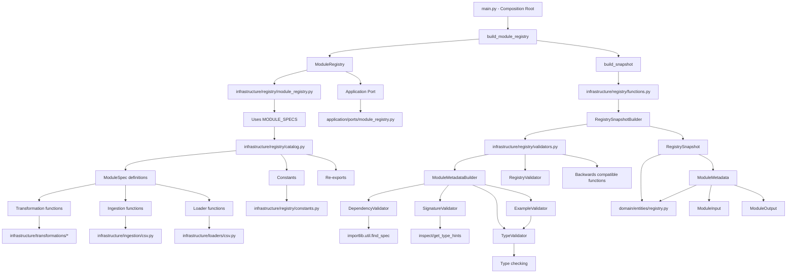

# Registry Flow - Component Diagram

## Flow Explanation

### 1. Initialization
1. **Composition Root** (`main.py`) calls `build_module_registry()` to create a configured registry instance
2. `build_module_registry()` (in `module_registry.py`) collects `MODULE_SPECS` from `catalog.py` and calls `build_snapshot()`

### 2. Snapshot Building
1. `build_snapshot()` (in `functions.py`) instantiates `RegistrySnapshotBuilder` which uses `ModuleMetadataBuilder`
2. `ModuleMetadataBuilder` orchestrates validation through specialized validators:
- **DependencyValidator**: Checks all declared dependencies are installable via `importlib.util.find_spec`
- **SignatureValidator**: Inspects function signatures using `inspect.signature()` and `get_type_hints()`, validates annotations
- **TypeValidator**: Validates types, defaults, and example values against declared schemas
- **ExampleValidator**: Ensures examples only use caller inputs (not pipeline inputs), have required values, and match types
- **RegistryValidator**: Factory for creating `RegistryError` instances

### 3. Metadata Derivation
For each `ModuleSpec`, the builder:
1. Validates dependencies are available
2. Checks name matches function name and module is in allowed prefix (`infrastructure.*`)
3. Inspects signature - first param must be `DataFrame` (pipeline input), rest must be keyword-only
4. Converts annotations to string type descriptors (`string`, `integer`, `number`, `boolean`, `enum[...]`, `array[...]`, etc.)
5. Builds `ModuleInput` objects with type info, required status, defaults, constraints
6. Validates defaults match declared types
7. Validates all examples
8. Constructs `ModuleMetadata` with full module information

### 4. Registry Creation
1. `RegistrySnapshotBuilder` creates a `RegistrySnapshot` containing all validated `ModuleMetadata` objects
2. `ModuleRegistry` wraps the snapshot and provides lookup methods (`get`, `require`, `function_for`) with version checking
3. The registry implements the `ModuleRegistryPort` interface from the application layer

### 5. Component Organization
- **Domain Layer** (`domain/entities/registry.py`): Core entities (`ModuleInput`, `ModuleOutput`, `ModuleMetadata`, `RegistrySnapshot`) with validation
- **Application Layer** (`application/ports/module_registry.py`): `ModuleRegistryPort` protocol defining the contract
- **Infrastructure Layer** (`infrastructure/registry/`): Implementation split into constants, catalog (specs), validators (logic), functions (builders), and module_registry (runtime)
- **Backward Compatibility**: `catalog.py` re-exports everything from the new modules
